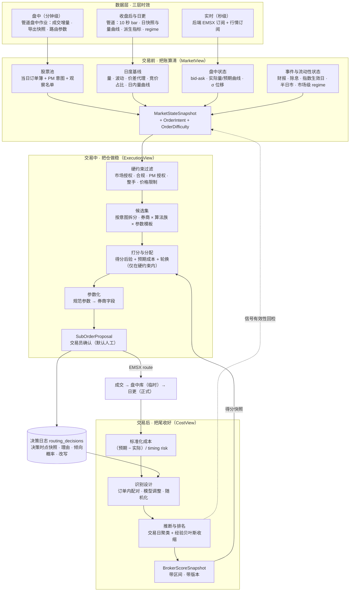
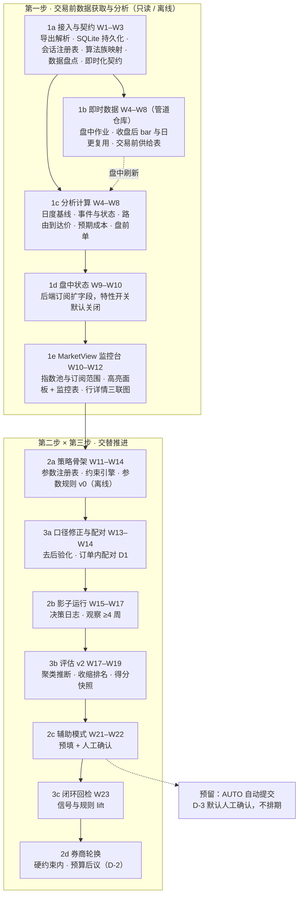

# 057 — 执行决策闭环：交易前检测 × 约束分配 × 交易后评估

> 特性（伞）：`057-execution-decision-loop`
> 形态：**伞计划**。本文件为总纲（目标、现状、设计、路线、风险、决策）；子任务 DL-01 至 DL-28 的逐项三栏（理论依据 / 技术方案 / 检验方法）、状态与 Agent 开工规程见 [`tasks.md`](tasks.md)。子任务开工时各自开 `specs/<feature-id>/plan.md`、独立 worktree 与分支、独立 PR（`docs/spec/git-workflow.md` §2、§4、§7）。
> 基线：`main@86b8c5a`（2026-10-20）。管道侧依据 [`docs/EMSXDataPipeline-TECHNICAL_GUIDE.md`](../../docs/EMSXDataPipeline-TECHNICAL_GUIDE.md) v1.0（对应管道 1.1.0），下文「指南 §x」均指该文档。
> 关联规范：`docs/spec/plan-design-principles.md`（G0–G3，落位见第 7 节）、`docs/spec/anti-patterns.md`、`docs/spec/git-workflow.md`。
> 来源：2026-10-19 至 10-20 的规划讨论。计划文本与子任务状态以本目录为准。

---

## 0. 结论与状态

- **一句话结论**：三个需求不是三个功能，而是一个闭环——交易前给出**决策时点的市场状态**，分配引擎在约束下做**可解释、可记录的决策**，交易后只用**决策前变量**做无偏评估，再把**带不确定性的券商得分**喂回分配。
- **现状**：管道已通，关节处没有决策逻辑。MV→EV、CV→EV 两条 handoff 只在 Execution 标签上显示徽标，没有进入任何路由决策；批量路由的券商比例、默认 VWAP、18% 量上限都是人工或全局常数。分析数据只有日更：每天 10:00 触发，跑完才有前一天的数据。
- **开发顺序（D-0）**：先建交易前数据获取与分析工具——风险最低，也是后两步的先决条件；路由策略与执行评估随后按风险由低到高交替推进。第一步只读或离线；到 2c 辅助模式之前都不改下单入口；每一步交付时冻结下一步要用的契约。
- **数据即时化（R0）**：与 EMSXDataPipeline 联合开发三层时效——秒级状态由后端现有订阅提供，自己的执行数据分钟级进盘中库，各市场行情收盘后即取，日更仍是正式版本；并把管道已规划的日快照表与 Parquet 批量通道接进来（4.0）。
- **决策状态（2026-10-20）**：D-0 至 D-5 均已定（第 10 节）。
- **搁置项**：S17 授权占用累计口径（053）与 5.3 驱动循环 submit 接线保持搁置，本计划不依赖二者。

## 1. 目标闭环

三段结构对应「交易前·把账算清 / 交易中·把仓做稳 / 交易后·把尾收好」（来源见 3.1）；贯穿三段的脊柱是**决策日志**，底座是**三层时效的数据层**。



## 2. 现状盘点（代码证据）

一句话概括：**MarketView = 日频静态快照；ExecutionView = 人工比例 + 静态规则；CostView = 统计流程严谨，但评估设计还识别不出券商技能；数据链路 = 只有日更，当日数据要等次日。** 以下每条都可在仓库定位（路径相对仓库根）。

### 2.1 交易前（MarketView）

| 维度 | 现状 | 证据 |
|---|---|---|
| 数据时点 | 日更产物 + 盘中库（管道 J1/J2）：股票池与日度基线读 `bdib_daily_summary` / `bdib_market_snapshot`，盘中特征与盘前单读盘中库；MarketView 不依赖 Bloomberg。日更 10:00 触发，亚太市场开盘前可用的正式基线只到 T−2，盘中作业填补当日 | `platform_data/adapters/market.py`（`get_market_snapshot`）；`MarketView/routers/marketview.py`；`docs/milestone-1-pretrade-board.md` |
| 股票池 | 4 个固定池：all / volatility-watch / liquidity-watch / active-names，不是当日订单簿、篮子或指数成分 | `platform_data/adapters/market.py:86` |
| 异常判定 | 全局常数：量比 2×/5× 与 0.5×/0.25× ADV20；日波动 25/40、日内波动 2/3。不分市场，不看个股自身历史分布 | `platform_data/adapters/market.py:45-53` |
| 价差 / 事件 / 日历 | 无 bid-ask；无财报、除息、指数生效日、半日市日历；只有交易所→时区映射，没有会话时刻（开收盘、午休、竞价窗口） | `data_access/common/exchange_tz.py` |
| 盘中监控（在 ExecutionView） | 行情订阅只有 `CHG_PCT_1D` `VOLUME_AVG_5D` `VWAP` `PX_ROUND_LOT_SIZE` 四个字段；MonitorBoard 条件是全局阈值（Qty/ADV 超 5%、涨跌超 4.5% 等），存在浏览器 localStorage | `backend/api/services/bloomberg/enrichment.py:395`；`ExecutionView/module/lib/monitor-conditions.ts:39-51` |
| 交接 | MV→EV 单槽 handoff，前端只显示候选数徽标，不进入路由决策 | `frontend/src/app/WorkspaceModuleTabs.tsx:61` |
| PM 指令（意图） | API 的 PM Note 即订单级字段 `notes`（Bloomberg `EMSX_NOTES`），只带 `^` 段（如 `^1234567^0`）；指令前缀（如 `80 % @Close`）只在 EMSX 手工导出的 PM Note 13 里，交易员盘中多次导出。路由上的同名字段是交易员给券商的指令，与此无关 | D-1；`backend/api/services/bloomberg/subscriptions.py:574`（订单 `notes`）、`:709`（路由 `notes`）；前端 PM Note 列 `ExecutionView/module/views/OrderTable.tsx:555`；持久化开启后随 `orders_projection` 的 payload 落盘（`subscriptions.py:877`） |
| 成熟度 | Beta（定义与判定证据见主 `README.md` §0；本行不复写计数）。池内量价/难度/成本同屏已实现（DL-29），SLA 与运维文档未实现 | `README.md` §0；`MarketView/tests/` |

### 2.2 分配与参数（ExecutionView）

| 维度 | 现状 | 证据 |
|---|---|---|
| 主工作流：批量路由 | 券商选择与比例人工；默认策略 VWAP；量上限 = 18% × 分配比例（全局常数），与个股 %ADV、价差、波动无关；起止时间手填后「应用到全部」 | `ExecutionView/module/components/batch-route-order/utils.ts`（`defaultStrategyFor`）；`use-batch-route-state.ts:838`；`ExecutionView/module/data/broker-volume-cap-mapping.ts:101` |
| 规则引擎：RoutePlan | 只按订单静态属性匹配（市场、代码通配、方向、组合、交易员、币种），参数是静态模板，没有市场状态条件 | `backend/api/services/route_engine.py:71-120` |
| VWAP 切片 | 用均匀成交量曲线兜底，未接入日内量曲线 | `backend/api/services/route_engine.py:245`、`:300` |
| 时区 ⚠️ | `_parse_end_time` 把本地时间当 UTC 解释，多市场下结束时间错位 | `backend/api/services/route_engine.py:418-432` |
| 参数字段映射 | 各券商起止时间、量上限的字段名只在前端维护，后端无法生成参数 | `ExecutionView/module/data/broker-time-mapping.ts`；`broker-volume-cap-mapping.ts` |
| 决策记录 ⚠️ | 建议单无理由、无市场快照字段；`routes_projection` 只存最新状态，且受 `ENABLE_DB_PERSISTENCE`（默认 false）门控；分析库只有 Broker / StrategyType / algo，没有参与率、起止时间等路由参数——持久化开启前，这些参数每天随进程丢失 | `backend/api/models/route_plan.py:159`；`backend/api/services/bloomberg/subscriptions.py:884`；`data_access/storage/schema/db_partition.sql:67` |
| 持久化与授权 ⚠️ | 持久化关闭时 PM 授权无法登记，下单入口的授权检查直接跳过；写入失败自进程启动累计 10 次即熔断回内存，`/api/health` 只测连接、不报熔断 | `backend/api/services/authorization_service.py:155`；`backend/api/service_provider.py`（`_max_write_errors`）；`backend/api/routers/connection.py` |
| CV→EV 推荐 | 手工 pin（上限 200，last-write-wins），同样只显示为徽标 | `backend/api/routers/broker.py`（`/api/broker-recommendations`） |
| 执行区间量价 | 监控板只有订单级 Ivl VWAP / Last Px / Arr Px 列，没有以执行区间为轴的曲线与累计量对照，也不能与全天走势切换（DL-30） | `ExecutionView/module/views/MonitorBoard.tsx`（列头 Ivl VWAP / Last Px / Arr Px） |

### 2.3 交易后（CostView）

| 维度 | 现状 | 证据 |
|---|---|---|
| 比较形态 | 027：每组 vs 其余，在 Exchange × 时段 × 规模 × 波动的共同层内比较、按样本量加权；Welch t / KS / χ² + BH；主基准固定为 arrival | `CostView/src/evaluation/report.py:51-59`；`comparability.py:43` |
| 控制变量后验化 ⚠️ | 「规模」= **成交量** ÷ ADV20，而非意图量；「时段」= **首笔成交**时刻，而非下达时刻；缺失时回退到 `par_rate` 与 `\|pnl_vwap\|`。四者都是算法表现的函数，按它们分层会把算法差异吸收进层里 | `CostView/src/monitoring/env_context.py:231`；`CostView/src/tca_utils.py:182-206` |
| 时段分桶 | 所有市场统一按 10:30 / 14:30 切。JP 有午休、LN 08:00 开盘、AU 10:00 开盘，同一刻度含义不同；管道 S9 已有 5 个市场（US、AU、LN、EU、JP）的会话分桶（`fill_regime_labels.time_bucket`），其余市场为空 | `CostView/src/tca_utils.py:161`；指南 §5.9 |
| 到达价锚点 ⚠️ | 按 003 口径 P0 = 首笔成交前最近 bar：算法等待期的漂移不计入 arrival cost；`delay_cost` 把交易员延迟与算法首笔延迟混在一起 | `docs/archive/2026-09-16/003-tca-core-benchmarks/plan.md:51`；管道 `fill_bdib.arrival_slippage_bps` 以订单首 bar 的 VWAP 为锚（指南 §5.4） |
| 推断 | route 级 iid bootstrap，未按交易日聚类；同日同票路由共享市场冲击，显著性被高估 | `CostView/src/evaluation/stats_tests.py:97-103` |
| 标准化与同类比较 | 无 σ√T 标准化、无市场调整、无本侧事前预期成本（K3）；收盘类算法与 VWAP 类算法同用 arrival 排名——对指数跟踪的收盘调仓单尤其不公平 | `CostView/src/evaluation/report.py:59`；`docs/report-tca-known-limitations.md` K3 |
| 自然实验未利用 | 批量路由天然产生「同一父单、同一窗口、多券商」样本，原型评估反而默认剔除（`one_broker_algo=True`） | 原型评估笔记的 `filter_fills`（仓库外） |

### 2.4 数据链路（EMSXDataPipeline）

| 维度 | 现状 | 证据 |
|---|---|---|
| 运行方式 | 三种形态：常驻 Runner（本机 :8100，单任务：`POST /run` 用子进程跑默认的 `--once`，即 S2→S3→S4→S6；`include_fetch=1` 改跑日更脚本；运行中再触发返回 409）；日更调度进程 `scripts/daily_update.py`（不经 Runner）；单次 CLI。启动统一由 `bootstrap.ps1` 拉起并做健康检查；EMSXView 经后端鉴权代理调 Runner | 指南 §2.3、§9.2–§9.4；`backend/api/routers/costview.py:54` |
| 更新时点 | 日更每天 10:00（本机时间）触发：拉成交 → S2–S10 全链 → manifest → WAL checkpoint → 维护同步 → 新鲜度检查（落后超过 1 个交易日 WARN、超过 2 个 FAIL）→ 报告钩子。前一天的数据要等这次日更跑完才可用；漏跑的日期由下一次日更顺带补上（2026-09-23 一次处理了 0921、0922 两天） | 指南 §9.3、§6.4；`docs/archive/2026-10-29/open-todos.md` T18 |
| 成交 | `//blp/emsx.history` 的 `GetFills`，按单日全窗口请求；拉取范围从最早已拉取日扫到上一工作日，不含当日；`fetch_log` 只认 `fetched` 状态判缺口；成交时间以纽约时间返回，S2 换算成交易所本地日期（拉取日 ≠ 交易日） | 指南 §4.1、§4.4、§5.1 |
| 行情 | xbbg `bdib` 10 秒 bar；证券范围 = 历史上成交过的证券（`ticker_repository`）∩ 26 个交易所白名单，正常日约 2,160 个；按 (ticker, 日期) 拉取、每批 50 个，并发上限保守（`MAX_PARALLEL_*` = 1）；安全日期：不超过上一工作日，本机时间 08:00 前再退一天（视为前一天的 bar 尚未就绪）；节假日表为空，只靠周末过滤与 `permanent_gap_dates` | 指南 §3.2、§4.2、§5.4、§11.1；`docs/archive/2026-10-29/open-todos.md` T22 |
| 额度 | 命中额度类错误或「应有数据却为空」时置 `quota_pause.json`，成交、行情、汇率、日指标、维护各入口一律短路；下一轮开头真实探测成功才清除 | 指南 §4.4、§8；`data_access/config.py`（`QUOTA_PAUSE_FILE`） |
| 增量起点 | S5 候选日期从 `raw_bdib` 最新日期 + 1 起，只向前看、不回看历史缺口 | 指南 §5.4；`docs/archive/2026-10-29/open-todos.md` T24 |
| 守卫与护栏 | S5 前置 `EmptyBarGuard` 与 `BDIBCoverageGuard`（ticker 覆盖率低于 0.5，或 ≥20 个 ticker 的市场整体缺失占比高于 0.3，告警不阻断）；各阶段连续 3 次 ERROR 熔断；启动前 `SchemaDriftGuard` 扫描 DDL 与写入路径，未知漂移直接阻断 | 指南 §6 |
| 存储 | 10 个库（活跃 9 个），合计约 128 GB，其中 `raw_bdib.db` 约 102 GB、3.7 亿行，查询必须带前导列；写连接 WAL + busy_timeout 30s，WRITE 层也拒绝 DELETE / DROP / ALTER；Parquet 双写默认关闭 | 指南 §2.2、§7；`AGENTS.md` §13.1 |
| 交易前供给 | 管道自列短板：Parquet 批量通道默认关闭；没有全市场当日快照表，下游只能自己扫 `raw_bdib`；`fill_bdib` 的涨跌幅与价差两列未接线、恒为 NULL。已规划 P1-A（开 Parquet）、P1-B（接线两列）、P1-C（快照表） | 指南 §10–§11 |
| 实时数据 | 只在 ExecutionView 后端：EMSX 订单与路由订阅、行情订阅（4 个字段），不进分析库 | `backend/api/services/bloomberg/subscriptions.py`；`enrichment.py` |
| 写入边界 | 管道是 `${EMSXVIEW_DATA_DIR}` 下全部库的唯一写入方；EMSXView 以 `mode=ro` 只读，两仓不互相 import；库表常量以管道 `config.py` 为真相源，本侧镜像由契约测试锁定 | ADR-0016；指南 §1.2–§1.4；`data_access/config.py` |
| 执行历史来源 | 已预留从 ExecutionView 投影补订单与路由（`executionview.*_projection`），尚未接通 | `data_access/config.py`（`EXECUTION_HISTORY_SOURCE_POLICY`） |

## 3. 设计原则

1. **风险由低到高、留好接口（D-0）**：先做只读与离线的事，再碰下单路径；每一步交付时冻结下一步要用的契约，之后只增不改。
2. **不可重建的数据在它出现的那一步落盘**：下达时刻的量价状态大多能由 BDIB 10 秒 bar 事后还原，不急；PM 意图与导出快照（DL-01 起导出文件在收件箱留档，DL-07 起入库）、路由参数（DL-02 持久化开启即落盘）、决策时点的报价价差与引擎候选、交易员改写（2b 起）事后无法重建，出现即落盘。
3. **三层时效，各取所长**：秒级状态只由后端现有订阅提供，管道不另开订阅；分钟级只取自己的执行数据；行情 bar 在各市场收盘后取、次日日更复用——额度是挪不是加。
4. **评估只用决策前变量**：分层键、协变量、预期成本一律取下达时刻之前可得的量；结果变量不得进入协变量或兜底代理。
5. **同类比较**：先按「意图 × 算法族」分组（VWAP 对 VWAP、收盘对收盘），再比券商；跨族比较只回答「这类订单该用哪类算法」（`docs/textbook/Algo_TCA.md:654`、`:826-832`）。
6. **排名必须带不确定性**：输出后验均值、区间与进入前 k 的概率；区间重叠的券商归入「不可区分集合」——轮换只在这里、且只在通过全部硬约束的候选内进行（D-2，预算后议）。
7. **先影子、再辅助；默认人工确认（D-3）**：引擎先只产出建议并记录（SHADOW），再预填批量路由（ASSIST），每笔由交易员确认；AUTO 只保留模式枚举与熔断接口，不排期。全程复用 S14 统一提交服务的保护。
8. **每个信号自证价值**：交易前告警与参数规则按月回检其对实际成本的预测力（lift），无增量即下线。
9. **守住既有边界**：`data_access` 只读、EMSXDataPipeline 唯一写入方、MarketView 不直连 Bloomberg、跨域只经 `platform_data`、单 PR ≤200 行、G0–G3 门控（`docs/spec/plan-design-principles.md`）。
10. **呈现效果与用户反复沟通打磨确定**（D-6）：面向交易员的呈现（盘前单表格、指标列、告警、辅助模式建议单）不追求一次定型——每阶段先交付可讨论的版本，按用户反馈反复迭代，以沟通打磨后的效果为准。该原则是第 5 节三个阶段性节点各自的出口条件之一。

### 3.1 外部依据

设计理念的来源（外部文章与个人笔记，不在本仓库）：

| 来源 | 要点（意译） | 落到本系统 |
|---|---|---|
| 熊猫交易员《宏观交易101 第五课：Trading Skills》（湖畔公寓28号，2016-11-02） | 交易员要吃透市场的呼吸节奏：流动性窗口、策略容量、承受冲击的能力、交易成本；多时区多品种下，新手常误入流动性很差的窗口而不自知 | 交易前检测的四个输出正对应这四项：窗口（会话时段、竞价占比、日内量曲线）、容量（意图量/ADV、按上限需要的交易时长、收盘竞价容量）、承受冲击（预期冲击与 timing risk）、成本（预期成本）；时段一律改为「市场会话相对时间」 |
| 同上 | 玩家的重要性看交易量而非资金量；放弃定价权的被动玩家，体量再大也只是路人 | 指数跟踪的调仓流是可预测的被动流：评分分项加入「信息泄露」（完成后回吐、下达前漂移），足迹明显的算法在建议理由中标出；调仓日样本单列 |
| 锦成盛《月度思考——2020 年 3 月》（2020-04-08） | 冲击第二阶段由流动性主导：微观流动性丧失，小幅调仓也会引发远超平常的波动，常规分析框架失效 | 市场级流动性状态（常态 / 紧张 / 错位）作为硬输入：错位时切换保守参数模板；该阶段样本单列，不混入常态排名（历史可复用管道 S8 的 `liq_regime`：换手率 z 值分 thin / normal / thick） |
| 付鹏，经用户笔记《一笔完整的交易的结构和元素》（锦成盛 × 付鹏，2026-10-15）转引 | 忽略市场的容积、容量、游戏规则与参与者，大资金会陷进去动弹不得；一笔交易分「交易前·把账算清 / 交易中·把仓做稳 / 交易后·把尾收好」 | 第 1 节的三段闭环；把「游戏规则」显式建为硬约束：涨跌停距离、竞价机制、半日市、整手、卖空规则 |

## 4. 模块设计

### 4.0 数据层：三层时效（与 EMSXDataPipeline 联合开发）

**目标**：把「前一天的数据要等次日 10:00 的日更跑完」改成：自己的执行数据分钟级可用，各市场行情收盘后即到，盘中状态秒级可见；日更仍是正式版本。

| 层 | 时效 | 内容 | 由谁取 | 写到哪 | 谁读 |
|---|---|---|---|---|---|
| 实时 | 秒级 | 订单与路由状态、路由参数、报价、当日累计量 | ExecutionView 后端现有 blpapi 会话（EMSX 订阅 + 行情订阅，DL-15 扩字段） | 内存；订单、路由状态与参数随 SQLite 持久化写运营库（DL-02） | ExecutionView 界面与约束引擎 |
| 盘中 | 分钟级，约 5 分钟一轮 | 当日成交（GetFills 增量；当日不可得时退回运营库路由快照）、EMSX 导出快照与 PM 意图、运营库中的订单状态与路由参数 | 管道新增的盘中调度进程，作业 J1（DL-07） | 当日盘中库 `${EMSXVIEW_DATA_DIR}/intraday/intraday_YYYYMMDD.db`，管道唯一写入，标记 provisional | MarketView 盘前单与盘中刷新；CostView 当日临时 TCA |
| 收盘后 | 各市场收盘 + 实测缓冲 | 该市场当日 10 秒 bar 与当日快照 | 盘中调度进程，作业 J2（DL-08，按会话注册表触发） | 当日盘中库（临时） | 次日 S5 直接复用、只补缺口；亚太开盘前即有 T−1 的临时快照 |
| 日更 | 每天 10:00 触发 | 全量成交、bar、派生指标、regime，以及新增的日快照与日内量曲线（DL-09） | 管道现有日更（`scripts/daily_update.py`） | 现有分析库（正式） | 全部模块 |

**分工与边界**

- **写入方不变**：管道是分析库与盘中库的唯一写入方；后端只写自己的运营库；MarketView 只读、不连 Bloomberg。
- **不重复订阅**：秒级行情与订单状态只由后端订阅；管道盘中只发请求类调用（GetFills 增量、收盘后 bar），额度可预算。
- **管道读运营库**：J1 以只读方式打开 ExecutionView 的 SQLite 运营库（与 ADR-0016 的 `mode=ro` 对称），接通已预留的 `executionview.*_projection` 来源，路由参数从此进入分析口径；每轮用短事务读取，不阻塞后端写入与 WAL checkpoint。指南 §9.3 记载 `mode=ro` 连接在 checkpoint 前看不到新数据，J1 须实测能否读到最新提交；读不到就由后端定期做 PASSIVE checkpoint。
- **临时与正式**：盘中数据一律标 provisional；读侧按日期路由——正式库已有该日就用正式数据，否则用盘中库；差异进守恒审计，沿用「已解释缺口」机制。盘中库按交易日分文件，保留期满整文件清理（WRITE 层禁止 DELETE，不在库内删行）。
- **日更复用，不碰缺口判定**：J2 取到且通过守卫的 bar，次日 S5 拉取前先取用、`raw_bdib.source` 标注来源，不再重拉——额度从次日早上挪到前一天收盘后。J1 不写 `raw_fills` 与 `fetch_log`（日更按 `fetched` 状态判缺口），J2 不写 `raw_bdib`（S5 从最新日期 + 1 起算，T24）：提前写进正式表，当日会被当成已完成而跳过。
- **调度**：日更仍由 `scripts/daily_update.py` 在 10:00 执行，不经 Runner；J1、J2 放进新的盘中调度进程，由 `bootstrap.ps1` 拉起并纳入健康检查，交易时段低优先级、按市场开关；Bloomberg 拉取段与日更互斥，复用维护同步的跨进程锁模式（指南 §9.5）。Runner 的单任务模型不变。
- **额度分级**：全局 `quota_pause.json` 置位时盘中作业一律让路；盘中作业自己遇到额度错误只停盘中作业（独立标记），不置全局暂停，以免短路次日日更。
- **护栏复用**：J1、J2 套用 GuardPipeline（独立 run_id）；新表走管道的 schema 注册与迁移规范，先过 `SchemaDriftGuard`——未登记的漂移会在启动前阻断整条日更。

**连接键链**：导出 PM Note 13 的 `^` 段 = 订单级字段 `notes`（`EMSX_NOTES`；运营库 `orders_projection` 的 payload 中可取）→ EMSX 订单号（sequence）→ 路由（sequence + route_id）与成交（GetFills 的 OrderId、RouteId）。

**额度原则**：盘中不轮询行情 bar；盘中量价状态来自后端订阅，不占请求额度。若当日临时 TCA 确需盘中 bar，按「活跃订单证券、低频、每日上限」另行开启，先由 DL-05 测量额度。

**两仓契约**（DL-06 冻结）：盘中库按交易日分文件，表 `intraday_fills`、`blotter_snapshots`、`order_intent`、`route_params_snapshot`、`bars_10s_t0`、`snapshot_t0`；新库键在两仓 Config 登记，契约测试锁定；新鲜度清单 `intraday_manifest.json`（原子写；每个数据集的 as_of、水位、行数、状态、last_error，与管道 freshness SLA 同口径）；作业节奏、市场开关与互斥锁；运营库路径与只读口径；导出收件箱路径；provisional 语义与读侧按日期路由规则。两仓各立一篇 ADR；管道侧按指南 §13 的 T3、T4、T7 更新技术文档，并整体同步本仓库副本。

**联合开发流程**：契约先行 → 管道实现（特性开关，默认关闭）→ 本侧独立复验（沿用 `docs/archive/2026-10-29/open-todos.md` 的 T 系列协作记录）→ 按市场逐个开启。管道仓库私有，本侧以 `docs/EMSXDataPipeline-TECHNICAL_GUIDE.md` 为接口说明（管道侧每周核对、触发式 1 个工作日内更新，副本整体覆盖同步），据文档、新鲜度清单与对账结果复验。

**与管道既有优化路径对齐**（指南 §11）：P1-A（开启 Parquet 批量通道）与 P1-C（全市场日快照表）并入 DL-09，快照表再扩充日内量曲线与竞价占比，作为 DL-10 基线与 DL-13 拟合的数据源；P3（交易日历）与 DL-03 的假日、半日市合为一份数据；P1-B（`fill_bdib` 涨跌幅与价差两列接线）需额外 Bloomberg 字段，本计划不依赖。

**核对结论**（指南 v1.0）

- Runner 与调度：Runner 单任务，日更走独立调度进程 → 盘中作业另起调度进程（见上）。
- 库表与 Parquet：10 个库（活跃 9 个）；Parquet 双写默认关闭，开启即 P1-A，并入 DL-09。
- 安全日期：本机时间 08:00 是「前一天 bar 已就绪」的全局经验值，不分市场；J2 改用按市场的「收盘 + 缓冲」。
- 完整性守卫：`EmptyBarGuard`、`BDIBCoverageGuard`、RetryPolicy、outdated 墓碑与额度暂停均可直接复用。
- 仍需在交易机上实测：GetFills 对当日成交的可得性与延迟（指南未涉及，DL-05）；各市场收盘后 bar 完整所需的缓冲（DL-05）；`mode=ro` 能否读到运营库未 checkpoint 的提交（DL-07）。

### 4.1 R1 交易前检测：股票池量价变化

**股票池三层**：当日订单簿（EMSX 导出快照 + 运营库订单，含 `basketName`）；指数调仓预告名单或成分股；交易员观察名单。

> **批次落位（2026-10-28 调整）**：节点一的证券范围统一由**指数池成分股**确定——池是监控台与行情订阅的共同范围（DL-31），当日订单簿池与观察名单不在本批范围，后续另立任务。开发验证阶段用 9 个 ticker 的配置池（`dev-validation`），验证通过后再接指数全集。原 1e/DL-29 的固定筛选池同屏方案由 DL-32 取代。

**EMSX 订单导出（D-1）**：PM 指令只能从这里取得。交易员盘中多次导出，每份是一个时点快照；同一订单以最新一份为准，旧份留档。导出列按用途分组（以附录 A 样例为准）：

| 用途 | 导出列 | 用法 |
|---|---|---|
| 意图与连接键 | PM Note 13 | 写法见下表；`^` 段与订单级字段 `notes` 一致，作连接键 |
| 订单要素 | Code、Exch Code、Name、Side、Qty、Curncy、LMT、Status、Mkt Stat、Create Time (As of)、Settle Date、Brkr Code、TS ID、GICS Ind Grp Name | Create Time 只有时分秒，日期取导出时间；真实导出的 Brkr Code 带 `EQ-` 前缀（样例已替换），与 API 券商代码的对应在 DL-01 核对 |
| 执行进度 | Work、FillQty、%Filled、Idle、% Rtd Qty、Exe Px、Working Val (USD)、FillVal (USD)、FillVal (Local)、`$value` | 盘中进度与名义额（`$value` 为 USD 名义额） |
| 规模与参与 | Q% 5D ADV、Q % tdy、Full day Part%、Day Part Rate %（两列同名） | 订单难度；Q % tdy 相对的是当日已成交量，随盘中变化 |
| 收盘竞价容量 | Clsg Auct Vol、Offic Cls Auct Vol、Rem Bal % Avg Cls Auct Vol、Prim Clsg Px | 收盘意图订单的容量检查；样例四笔的余量相当于日均收盘竞价量的 10.6%–45.0% |
| 价格状态 | % Chg D Tdy、OpenPx Vs LstBA (%)、LastPx Vs VWAP (Bps)、Last | 导出时点的价格位移与跳空 |
| 事件 | Exp Earn Rpt Time、Ex-Dvd Flag | 事件标记（DL-11） |
| Bloomberg 自带基准 | Vs ArrPx (Bps)、Vs IntervalVWAP (Bps)、IntervalVWAP、AvgPx Vs IntervalVWAP (Bps)、AvgPx Vs Lst Trd/Lst Px (Bps)、P/L (R) Bps vs. ArrPx、P/L (R) Currency vs. IntervalVWAP USD、P/L (R) Currency vs. Lst Trd/Lst Px USD | 只作本侧 TCA 的交叉核对，不作主口径 |
| 竞价指示 | Theor Vol、Theor Px | 样例为空，预计只在竞价时段有值（待核对） |
| 不入库 | A/c、Trader、Odd Lot、Settle Type、RC | A/c 与 Trader 含身份信息；原始导出留在仓库之外 |

到达价与区间 VWAP 相关的 6 列和两列 Day Part Rate %，在部分导出中显示为 Data Export Restricted，解析时按可选列处理。

**PM Note 13 写法 → 意图**

| 写法 | 意图 | 执行含义 |
|---|---|---|
| `^1234567^0` | VWAP | 全部按 VWAP 执行 |
| `100 % @Close^1234567^0` | CLOSE | 全部参与收盘竞价 |
| `80 % @Close^1234567^0` | MIX（收盘 80%） | 80% 参与收盘竞价，其余 20% 按 VWAP |
| `Spec.Instr.^1234567^0` | SPECIAL | 与 PM 沟通具体操作；引擎不出自动建议 |
| 其他写法 | UNMAPPED | 进未匹配清单，人工补登 |

**解析规则**：按第一个 `^` 切开——前缀是指令，`^` 及其后（如 `^1234567^0`）是连接键，只与订单级 `notes` 匹配。前缀匹配「数字 % @Close」得到收盘比例，匹配 `Spec.Instr.` 为特殊指令，空前缀为 VWAP；保留原文 `raw_note`；映射表带版本。同一连接键在后续导出里指令变化时，按导出时间记新版本，不覆盖旧版本。

**导入两阶段**

1. **只读 MVP（DL-01）**：MarketView 读收件箱里最新一份导出 → 盘前单 v0；不落库，不碰 Bloomberg。
2. **入库（DL-07）**：管道 J1 每轮扫描收件箱，写 `blotter_snapshots` 与 `order_intent`；MarketView 改读表，直读路径删除。两侧解析以同一份样例为金标准做契约测试。附录 A 样例已脱敏，可直接作仓库夹具的底稿；但 PM Note 13 已整列遮蔽，夹具需另填虚构连接键，覆盖五种写法（无前缀、`100 % @Close`、`80 % @Close`、`Spec.Instr.`、未知前缀），`***` 的数值列填虚构数值；原样遮蔽版另留一份，测试遮蔽值与受限值按缺失处理。**本仓库公开，禁止提交任何真实订单数据。**

| 层 | 时点 | 内容 | 方法（替代全局常数） | 落位 |
|---|---|---|---|---|
| A 日度基线 | 盘前批处理 | 量、波动、隔夜跳空、动量、价差代理、开/收盘竞价占比、个股日内累计量曲线、量能结构变化（ADV5 ÷ ADV60） | 个股自身 60 日稳健分布：log 量的 median/MAD z 值、波动分位数、跳空的 σ 倍数；估基线前剔除指数调仓日等特殊日；T−1 数据优先取收盘后作业的临时快照；量纲先对齐（`daily_volatility` 为百分比、`intraday_volatility` 为小数） | 新只读适配器 `platform_data/adapters/`（读 DL-09 的日快照与日内量曲线、`bdib_daily_summary` 与盘中库；直读 `raw_bdib` 时守取数通道规则）+ MarketView 端点 |
| B 订单难度 | 订单进入时，盘中刷新 | 意图量 ÷ ADV20、按参与上限需要的交易时长、预期成本与 timing risk；收盘段量 ÷ 日均收盘竞价量 | 预期成本模型 v0：幂律冲击 + σ√T，复用 `CostView/src/evaluation/cost_model.py` 在本侧数据上拟合（DL-13）；收盘容量阈值按市场校准 | backend 服务（读 A 层基线） |
| C 盘中状态 | 实时 | 价差 bps 相对基线、实际累计量 ÷ 预期曲线、相对到达价的 σ 位移、在途路由实际参与率 vs 上限 | 后端订阅扩到 BID / ASK / LAST_PRICE / VOLUME / HIGH / LOW（只加字段，不加证券数）；阈值服务端统一、带版本 | `backend/api/services/bloomberg/enrichment.py` 与 WS 推送；MonitorBoard 改为 z 值条件（DL-15，特性开关，默认关闭） |
| D 事件与状态 | 盘前 + 盘中 | 财报、除息、指数生效日、半日市与假日、停牌、涨跌停距离；市场级流动性状态 | 事件用导出字段，不新增 Bloomberg 调用；指数生效日与半日市来自会话日历；市场级状态：日级沿用管道 S8 的 `liq_regime`（换手率 z 值分 thin / normal / thick）与 `vol_regime`，盘中叠加截面价差 / 量 / 波动 z | MarketView；状态标签经契约交给执行侧 |

**输出契约**（`platform_data/contracts/`，第一步冻结 v1）：`OrderIntent`（order_key、benchmark、close_pct、raw_note、intent_source、valid_from、export_ts）、`MarketStateSnapshot`（逐票特征向量，带 schema 版本）、`PreTradeSignal`（code、severity、z 值、证据）、`OrderDifficulty`、`DataFreshness`（数据集、as_of、滞后）。MV→EV handoff 升级为 v2，携带逐单特征而不只是候选名单。

**验收**：盘前单在所辖首个市场开盘前 30 分钟可用，盘中随作业刷新；意图覆盖率与未匹配清单可见；每个数据集的新鲜度可见、超时标红；所有阈值可追溯到版本；新增能力有测试覆盖，`AGENTS.md` §4.2 成熟度表同步并公开已知限制清单后，MarketView 晋级 Beta；每类信号有月度 lift 报告。

### 4.2 R2 约束分配与参数设置

**决策流水线**：订单 + `OrderIntent` + `MarketStateSnapshot` → 按意图拆分（MIX 拆成收盘段与 VWAP 段；SPECIAL 不进引擎，只记录交易员的选择）→ 硬约束过滤 → 候选集（券商 × 算法族 × 参数模板）→ 打分（`BrokerScoreSnapshot` 中标准化成本的后验 + 预期成本 + 轮换，轮换仅在硬约束内；其余分项只随理由展示）→ 分配（券商数、比例）→ 参数化（规范参数 → 券商字段）→ `SubOrderProposal`（带 `decision_id`）→ 交易员确认或改写（S14 统一提交服务）→ 决策日志。

| 类型 | 约束 | 数据来源 | 现状 |
|---|---|---|---|
| 硬约束 | 市场 → 可用券商 | `market_broker_mapping` | ✅ 已有 |
| 硬约束 | 券商在该市场支持的算法与参数结构 | EMSX 券商策略缓存（`/api/broker-algorithms`） | ✅ 已有，需后端化 |
| 硬约束 | 名义额上限、整手、odd lot | `compliance_service` | ✅ 已有 |
| 硬约束 | PM 授权量与剩余量 | S12 / S13 授权服务 | ✅ 单次量级有效，SQLite 持久化开启后生效（DL-02）；累计口径随 S17 搁置 |
| 硬约束 | 涨跌停距离、竞价可用、半日市、卖空规则 | 会话注册表 + refdata | ❌ 新增 |
| 硬约束 | 单券商集中度上限（当日名义额占比） | 配置 | ❌ 新增 |
| 目标 / 软约束 | 意图：VWAP / 收盘 / 混合 / 特殊指令 | PM Note 13（D-1）；无导出时引擎按 VWAP 默认并标注 `intent_source`，盘前单提示补导出 | ❌ 新增 |
| 目标 / 软约束 | 收盘竞价容量：收盘段量 ÷ 日均收盘竞价量 | 导出 Rem Bal % Avg Cls Auct Vol + 本侧基线 | ❌ 新增；超阈值提示交易员与 PM 沟通 |
| 目标 / 软约束 | 紧迫度、完成期限、最大参与率 | 订单难度 + 规则 | ⚠️ 仅全局 18% |
| 目标 / 软约束 | 券商数量上下限、轮换预算 | 配置；轮换预算后议（D-2），默认关闭 | ❌ 新增 |

**参数策略 v0**（透明规则、版本化，先可审计，后学习）：

- 意图 → 算法族：VWAP → VWAP 族；CLOSE → 收盘竞价族；MIX → 收盘段走收盘竞价族、其余走 VWAP 族（两条路由，或券商支持的组合参数）；SPECIAL → 不生成建议。
- 总参与率目标 `p*` = clip（f（意图量 ÷ ADV20，紧迫度，价差 z，波动分位），p_min，p_max_市场）；各券商上限 = `p*` × 分配份额，取代 18% × 比例。
- 时间窗按会话相对时间：开盘竞价占比低或价差偏宽时避开开盘后前 N 分钟；VWAP 段在收盘竞价前结束。
- 价格保护：高波动日按 σ 倍数设置限价或 I-would 价。
- 状态切换：市场处于「紧张 / 错位」时自动套用保守模板。

**规范参数注册表**：把前端 `broker-time-mapping.ts`、`broker-volume-cap-mapping.ts` 的知识上移为后端契约——规范字段（start_time、end_time、max_pov、min_pov、urgency、auction_open、auction_close、i_would_px）→ 各券商 × 策略的字段名、类型与格式（如 HHMM 整数、整数型上限券商）；前端在 2c 与预填一起改读 API，成为唯一真相源。

**RoutePlan 扩展**（向后兼容）：`match_conditions`（对特征的条件表达式，如 qty_pct_adv、spread_bps、vol_pct、意图与收盘比例、事件标记）、`allocation_mode`（FIXED / PERCENT / SCORE / WHEEL；WHEEL 只在通过全部硬约束的候选内轮换）、`param_template_id`。

**决策日志** `routing_decisions`（SQLite 运营库，沿用 S8 / S15 持久化模式）：decision_id、order_id、时间、模式（MANUAL / SHADOW / ASSIST；AUTO 预留）、policy_version、意图、market_state_snapshot（含决策时点的报价价差）、逐项约束结果、候选与得分、最终分配与参数、是否轮换与倾向概率（D-2 预留）、交易员改写与原因码、关联 route_ids。2b 以影子方式落地：订单到达时由引擎生成建议并落盘，实际选择从路由订阅捕获，不改下单入口；2c 起把 decision_id 写进提交请求。SPECIAL 订单同样记录交易员的实际执行方式，供事后归类。

**所有权与流转**：写在 ExecutionView 运营库；进入分析口径由管道 J1 只读采集（4.0），保持唯一写入方不变。

**模式（D-3：默认人工确认）**：SHADOW（只算不用，交易员照常手工路由，建议与实际并排落盘）→ ASSIST（一键预填券商集合、比例、策略、参数并附理由；每笔由交易员确认，改写需选原因码）。AUTO 不排期，只在 `mode` 枚举与熔断开关中预留。

**顺手修复**（2a，随 DL-18）：`_parse_end_time` 时区；VWAP 切片接入日内量曲线。

**验收**：2b 起 100% 路由订单有决策记录；建议单零硬约束违例（含轮换）；影子期周报给出一致率、预期成本差、改写率与原因分布；常用券商 × 策略组合 ≥90% 能自动生成参数。

### 4.3 R3 交易后科学评估与券商排名

**结果变量按意图分开**（意图取自 PM Note 13；导出归档开始前的历史订单按实际算法族推断，并标注 `intent_source`）：

- VWAP → 区间 VWAP 偏离（导出里的 AvgPx Vs IntervalVWAP 作交叉核对）；
- CLOSE → 收盘价偏离（含竞价参与，`is_closing_auction` 已在管道数据中）；
- MIX → 两段分别对各自基准，父单层面用按收盘比例加权的混合基准；
- SPECIAL → 以路由下达时刻为锚的 IS，按交易员记录的实际执行方式归类；
- 全部订单另算到达类诊断：以路由下达时刻为锚（`p_route_arrival`），拆分交易员延迟（决策 → 下达）与算法延迟（下达 → 首笔）。

**当日临时版**：J1 成交加 J2 收盘后 bar，各市场收盘后即可出当日临时 TCA（provisional）；次日日更为正式版，差异进守恒审计。排名只用正式数据。

**标准化**：z =（预期成本 − 实际成本）÷ timing risk，正值更好；预期成本用本侧统一模型而非券商自报（`docs/textbook/Algo_TCA.md:501-519`），并给出市场调整版（剔除 β × 指数同期收益，`:483`、`:521-531`）。预期成本按**实际成交股数**计算，未成交部分单列机会成本（`:517`）。

| 识别设计 | 适用样本 | 做法 | 消除了什么 |
|---|---|---|---|
| D1 订单内配对 | 同一父单、同批下达、同窗口的 ≥2 券商路由（同算法族） | 路由成本 − 组内成交额加权均值；Wilcoxon 符号秩 / 符号检验（`Algo_TCA.md:567-651`）+ 订单固定效应回归，各自份额作协变量 | 市场漂移、个股当日难度、交易员对订单的选择 |
| D2 模型调整 | 单券商订单 | 对决策前协变量回归（意图量 %ADV、价差、波动分位、会话相对时段、方向 × 动量、市场、流动性状态）后比较残差 | 可观测的构成差异 |
| D3 随机化轮换 | 2d 起的轮换样本（D-2：仅在硬约束内，预算后议） | 按日志记录的倾向概率做 IPW | 不可观测的选择偏差（金标准） |

**推断**：按交易日聚类的稳健标准误与块 bootstrap，取代 route 级 iid；保留 BH 校正与功效 / MDE 披露。

**排名**：单元 = 券商 × 算法族 × 市场组 × 规模档，样本不足逐级回退（→ 券商 × 算法族 → 券商）；DerSimonian–Laird 经验贝叶斯收缩（闭式解，仅需 numpy，与「不引入 statsmodels」一致）；输出后验均值、90% 区间、进入前 k 的概率、有效样本量。区间分离才分 A / B / C 档，否则归入不可区分集合。

**分项得分**：标准化成本 · 尾部风险（z 的 CVaR）· 完成率与机会成本 · 信息泄露（30 分钟回吐，复用管道 S10 的 `reversal_30m_bps`；下达前漂移）· 运营质量（拒单、NEEDS_REVIEW、首笔延迟）。分配引擎按标准化成本的后验排序，其余分项随建议理由展示，不加权合成。综合评分不排期（D-5），快照预留权重与版本字段，需要时再启用。

**稳定性**：13 周滚动窗口 + 指数衰减；对每家券商的标准化残差做 CUSUM 漂移告警；流动性错位期样本单列。

**输出契约**：`BrokerScoreSnapshot`（as_of、窗口、口径版本、各单元统计）经拉取式 API 提供给分配引擎；手工 pin 保留为人工批注，不再作为分配输入。

**数据修正前置（3a）**：规模改用意图量 RouteShares ÷ ADV20；时段改用下达时刻 + 会话相对；删掉 `par_rate` 与 `|pnl_vwap|` 兜底（缺失计 unknown 并披露覆盖率）；`p_route_arrival` 在 1c 已就绪（DL-12：本侧按 `route_as_of_time` 自给，上游物化到 `tca_route_summary` 后对账切换）。

**验收**：z 值校准（各规模档、算法族均值约 0、标准差约 1，容差内）；排名附区间；D1 样本覆盖率披露；相邻窗口排名秩相关披露；快照被分配引擎消费。

## 5. 分阶段路线

**阶段性节点**（D-6，2026-10-21；1e 于 2026-10-27 按模块使命补入；**节点一于 2026-10-28 重定义**）：下列三个节点是本计划的验收里程碑，与第 6 节需求矩阵对应（节点一 ↔ R0/R1，节点二 ↔ R2，节点三 ↔ R3）。节点内批次按上图节奏推进（1a–1e → 2a/3a → 2b/3b → 2c/3c → 2d），节点之间以前一节点的出口判据为门槛；每个节点的呈现效果按原则 10 与用户反复沟通打磨后定稿。**1e 的定位**：补齐市场走势视图的基本使命（边界见 [`AGENTS.md` §4.0](../../AGENTS.md)），只读、不进入下单路径。

**节点一重定义（2026-10-28）**：节点一收敛为 MarketView 单一监控台——一个高亮信息面板 + 一个监控表 + 行点击弹出的三联图详情；证券范围由**指数池成分股**决定，开发验证阶段固定 9 个 ticker（每市场一个），验证通过后再扩指数全集。三项连带决定：① 原固定筛选池池板（DL-29 前端）由 DL-32 取代，其取数层与额外订阅机制保留复用；② ExecutionView 执行区间量价视图（DL-30）**移出节点一**，按执行侧需要另排，不再作为节点一出口判据；③ 节点一不再要求成本列与意图覆盖率同屏——成本留待 DL-13 校准后按需接入。

| 节点 | 目标 | 覆盖 | 出口判据 |
|---|---|---|---|
| 节点一 · MarketView 交易前监控台 | MarketView 前端 = 高亮信息面板（Liquidity / Volatility / Risk notes 三模块，各列异常 ticker）+ 每行一只股票的监控表（14 列），点击行弹出三联图详情；证券范围由指数池成分股决定，开发验证阶段固定 9 个 ticker | 1a–1d、1e（DL-01 至 DL-15、DL-29 取数层、DL-31 至 DL-33） | 9 个验证 ticker 全部出现在表内（缺数据显式标注、不消失）；三模块与表内 Liquidity/Volatility/Risk notes **同源同值**；行详情三联图共享同一时间轴、缺 bar 显式 gap 不插值；逐字段 `as_of` 与来源（live / bar / baseline）可见；只读、无新增写库路径；呈现效果经用户打磨定稿 |
| 节点二 · 合规路由与券商选择 | 建立完备的合规 + 风险检查系统，正确生成合规的订单路由指令；实现路由订单的券商选择算法；成功路由订单 | 2a–2d（DL-16 至 DL-27） | 新增硬约束（涨跌停距离、竞价可用、半日市、集中度等）零违例；引擎能正确生成合规的订单路由指令；券商选择有可解释理由与完整决策日志；ASSIST 模式下每笔经交易员确认并成功路由；改写原因码回流 |
| 节点三 · 科学评估执行表现 | 建立模型科学系统评估执行表现 | 3a–3c（DL-19 至 DL-26） | 控制变量去后验化落地；订单内配对（D1）覆盖率披露；z 值校准通过、排名带区间；得分快照被分配引擎消费；每类信号有月度 lift 报告 |

> **节点一交付状态**：1a–1d 已完成（见 [`docs/milestone-1-pretrade-board.md`](../../docs/milestone-1-pretrade-board.md)）；DL-29/DL-30 已于 2026-10-27 实现（097/098），其中 DL-29 的取数层与额外订阅机制在本轮重定义中保留复用、前端池板退役，DL-30 移出节点一。**新节点一（2026-10-28 起）待开发**：DL-31 → DL-32 → DL-33 按序推进。
>
> **前端复核清单（新节点一）**
> - [ ] 高亮面板：三模块分别只列本模块指标异常的 ticker，点击条目可定位到表内行
> - [ ] 监控表 14 列齐备（Ticker / Name / Status / Last / Chg % / Close / Total Vol / ADV 20D / Vol÷ADV20 / Daily Vol / Intraday Vol / Liquidity / Volatility / Risk notes），列顺序与用户给定一致
> - [ ] 缺数据的单元格显示 `—` + 悬浮原因，不显示 0、不隐藏行
> - [ ] 行点击打开抽屉：上（10 分钟价格—成交量分布 + O/H/L/C 标注）、中（当日 vs 前五日均累计量）、下（累计量占比 0–1），三图同一 x 轴
> - [ ] 抽屉摘要显示 `trade_date / bars / gaps / prev5_days / source`
>
> 复核通过后节点一即可关闭；待调整项记入 DL-31/32/33 追加改动。



| 批次 | 周次（约） | 子任务 | 风险 | 出口标准 |
|---|---|---|---|---|
| 1a 接入与契约 | W1–W3 | DL-01 导出解析与意图映射 · DL-02 SQLite 持久化开启与加固 · DL-03 会话注册表 · DL-04 算法族与意图映射 · DL-05 数据盘点与额度测量 · DL-06 即时化契约与双仓 ADR | 低：只读、离线；DL-02 中低（运营配置，048 已彩排） | 盘前单 v0 可用；意图覆盖率与未匹配清单可见；持久化连续一周无熔断、备份可恢复；`OrderIntent` 与即时化契约 v1 在两仓冻结 |
| 1b 即时数据 | W4–W8 | DL-07 盘中作业 J1 · DL-08 收盘后 bar 与日更复用 · DL-09 交易前供给表与批量通道 | 中低：管道新进程与新表，特性开关默认关闭，不改日更既有判定逻辑 | 盘中库滞后不超过一个作业周期；收盘后 bar 通过完整性守卫；日更复用后额度不增、结果不变；快照与量曲线与明细对账一致；`SchemaDriftGuard` 通过 |
| 1c 分析计算 | W4–W8 | DL-10 日度基线 · DL-11 事件与流动性状态 · DL-12 路由到达价 · DL-13 预期成本 v0 · DL-14 盘前单与 handoff v2 | 低：只读 | 盘前单在首个市场开盘前 30 分钟可用、盘中随作业刷新；`MarketStateSnapshot`、`OrderDifficulty` 冻结；预期成本附校准报告 |
| 1d 盘中状态 | W9–W10 | DL-15 盘中市场状态 | 中低：扩订阅字段；特性开关，默认关闭 | 开关开启时订阅延迟与额度在预算内；关闭即回到现状 |
| 1e MarketView 监控台 | W10–W12 | DL-31 指数池与订阅范围 · DL-32 监控台聚合端点 · DL-33 行详情三联图 | 低–中低：只读汇总与新只读端点，不进入下单路径 | 9 个验证 ticker 全部在表；三模块与表列同源同值；三联图同轴、缺 bar 显式 gap；无新增写库路径 |
| 2a 策略骨架 | W11–W14 | DL-16 规范参数注册表 · DL-17 约束引擎 · DL-18 参数策略 v0（含时区修复） | 低：后端离线计算，不接提交 | 历史订单回放零硬约束违例；常用券商 × 策略组合 ≥90% 能生成参数 |
| 3a 口径修正与配对 | W13–W14 | DL-19 控制变量去后验化 · DL-20 订单内配对评估 D1 | 低：离线，只改报告口径与新增分析 | golden 基线差异逐项解释入档；新旧口径对照报告；D1 样本覆盖率披露 |
| 2b 影子运行 | W15–W17，之后观察 ≥4 周 | DL-21 决策日志（影子方式）· DL-22 影子模式与周报 | 中低：新增落盘，不改下单入口 | 100% 路由订单有决策记录；连续 4 周影子周报 |
| 3b 评估 v2 | W17–W19 | DL-23 聚类推断与收缩排名 · DL-24 得分快照（分项） | 低：离线 | z 校准通过；排名带区间；快照 API 可用（只含分项，D-5） |
| 2c 辅助模式 | W21–W22 | DL-25 辅助模式（人工确认） | 中：首次改动批量路由界面 | 用户确认进入 ASSIST；每笔人工确认；改写原因码回流评估 |
| 3c 闭环回检 | W23 | DL-26 信号与规则回检 | 低 | 每类信号有月度 lift 报告；无增量信号的下线记录 |
| 2d 券商轮换 | 待 D-2 | DL-27 券商轮换（硬约束内） | 中 | 轮换预算定案；倾向概率入日志；样本足以出 D3 结论 |
| 预留 | 不排期 | DL-28 自动提交 | 高 | 只保留 `mode` 枚举与熔断接口（D-3） |

周次按 029 / 053 两轮的实际节奏估算（单人 + 代理，一子任务一 PR，≤200 行 diff）。EMSXView 与 EMSXDataPipeline 两条线并行：1b 在管道仓库，与 1c 同期；1c 先用日更数据交付，1b 就绪后盘前单接上盘中刷新；DL-10 在 DL-09 就绪前按取数通道规则直读明细。DL 编号即执行顺序，与 `tasks.md` 一致；用 DL-xx 是为了不与 029 / 053 的 S1–S17 混淆。子任务的子编号从 058 起在派工时顺序分配，子规格沿用 030–048 的单文件 `plan.md` 写法（见 `tasks.md` 开工规程）；管道侧子任务按其仓库规范另立 spec。

## 6. 需求 ↔ 子任务双向矩阵

| 需求 | 直接覆盖 | 必要前置 | 验收指标 |
|---|---|---|---|
| R0 数据即时获取与更新 | DL-06 · DL-07 · DL-08 · DL-09 | DL-02 持久化；DL-03 会话注册表；DL-05 额度测量 | 各数据集滞后；每日 Bloomberg 请求量；临时版与正式版差异 |
| R1 交易前检测股票池量价变化 | DL-01 · DL-10 · DL-11 · DL-13 · DL-14 · DL-15 · **DL-29** · **DL-31** · **DL-32** · **DL-33** | DL-03；DL-04 意图与算法族映射；DL-05 数据盘点；DL-07 至 DL-09 即时数据与供给表；DL-12 路由到达价（预期成本的拟合目标） | 盘前单准时率与新鲜度；PM 意图覆盖率；告警 lift；盘中状态延迟；池成员覆盖率与订阅截断率；行详情 gap 可见率 |
| R2 按约束分配券商算法与参数 | DL-16 · DL-17 · DL-18 · DL-21 · DL-22 · DL-25 · DL-27 · **DL-30** | DL-01 PM 意图；DL-02 持久化；DL-03；DL-04；DL-11 事件与状态；DL-24 得分快照 | 决策记录覆盖率；硬约束违例数（含轮换）；影子一致率与预期成本差；改写率与原因分布；执行区间偏离可见 |
| R3 科学评估与券商排名 | DL-19 · DL-20 · DL-23 · DL-24 · DL-27 | DL-01；DL-04；DL-05；DL-07 至 DL-09 当日临时数据；DL-12；DL-13 预期成本 | z 校准；排名区间宽度；D1 覆盖率；相邻窗口秩相关；临时版与正式版差异 |
| 跨需求 | DL-26 信号与规则回检 | DL-14；DL-24；DL-25 | 无增量信号下线记录 |
| 预留（D-3） | DL-28 自动提交：不排期 | — | 只保留 `mode` 枚举与熔断接口 |

## 7. G0–G3 门控落位

| 门控 | 本计划的落位 |
|---|---|
| G0 数据零受损（P1） | 本仓库不新增任何写分析库的路径（`data_access` 只读不变）；运营库开启 SQLite 前后有备份与恢复演练（DL-02）；盘中作业只写当日盘中库、不写正式表（4.0）；管道新表走迁移规范、先过 `SchemaDriftGuard` |
| G1 三栏齐备（P2） | `tasks.md` 每个 DL 都有理论依据 / 技术方案 / 检验方法；前置验证集中在 DL-05（含交易机实测三项） |
| G2 全程防漂移（P3） | 新能力一律特性开关、默认关闭、按市场逐个开启；SHADOW → ASSIST 渐进；两仓契约测试锁定常量；golden 基线差异逐项解释（DL-19）；偏差即关开关回退；子任务严守条目范围 |
| G3 充分且必要（P4） | 第 6 节双向矩阵；每个 DL 按其检验方法逐条验收，PR 描述附证据 |

## 8. 风险与对策

| 风险 | 表现 | 对策 |
|---|---|---|
| 单元样本不足 | 券商 × 算法族 × 市场组很稀 | 分级回退 + 收缩 + MDE 披露；先跑 DL-05 数据盘点再定粒度 |
| 历史数据的选择偏差 | 难单被分给「好」券商，好券商反而显得差 | D1 配对 + 决策前协变量；2d 轮换（D-2） |
| 配对样本的相互干扰 | 同票同窗多券商争夺同一流动性 | 结论限定为「竞争条件下的相对表现」；份额作协变量；与 D2 交叉验证 |
| 调仓足迹被识别 | 被动流可预测，调仓日前后被抢跑 | 泄露分项单列并在建议理由中提示；在约束内随机化时间窗；调仓日样本单列 |
| 盘中作业挤占额度 | 盘中请求与日更争用 Bloomberg 额度，次日日更被额度暂停短路 | 盘中不轮询 bar；收盘后 bar 由日更复用，额度是挪不是加；每日请求上限；全局暂停时让路，盘中作业自身的额度错误不置全局标记；DL-05 先测量 |
| 交易时段资源争用 | 管道作业与交易界面同机运行，10:00 的日更也落在亚太交易时段，争用 CPU、磁盘与 Bloomberg 连接 | 作业只做增量、低优先级、可按市场关闭；Bloomberg 拉取段与日更互斥（跨进程锁）；性能基线进验收 |
| 临时数据被当正式 | 当日临时 TCA 被拿去排名或对外 | provisional 标记贯穿到报告与 API；排名只用正式数据 |
| 盘中数据干扰日更判定 | 盘中作业写进正式表，日更会把当日当成已完成而跳过（`fetch_log` 判缺口、`raw_bdib` 增量起点） | 盘中只写当日盘中库，不写 `raw_fills`、`fetch_log`、`raw_bdib`；复用只在日更内部发生 |
| 新表阻断日更 | 新表 DDL 与写入路径不一致时，`SchemaDriftGuard` 在启动前阻断整条日更 | 新表走管道 schema 注册与迁移规范；CI 跑漂移扫描；开关关闭时不建表 |
| 运营库熔断 | SQLite 写入失败累计 10 次后退回内存，授权检查跳过、数据不落盘，健康检查仍显示正常 | DL-02：`/api/health` 增报熔断状态与失败计数；WAL 与 busy_timeout；收盘后备份与月度恢复演练 |
| 手工导出遗漏或过期 | 某天没导出，或导出后 PM 改了指令 | 盘前单显示最新导出时间与意图覆盖率；缺失时引擎按 VWAP 默认并标注；同一订单的意图按导出时间留版本 |
| 导出版面变动 | 列被增删、改名或显示为受限；某行字段数与表头不符，整行错位 | 按列名解析，缺关键列或字段数不符时报错，受限列按可选处理；连接键用 PM Note 的 `^` 段，不依赖列序与时间 |
| 跨仓依赖 | 管道排期滞后或接口变更；管道仓库私有，本侧只能经技术文档了解，文档可能落后于实现 | 契约先行、两仓契约测试；管道改动按指南 §13 更新技术文档并同步副本，本侧以新鲜度清单与对账结果复验；盘前单先用只读 MVP，管道就绪后切换；本侧保留自给的 L2 路径 |
| 行情订阅额度 | 订阅证券数或字段超限 | 只扩字段不扩证券；事件用导出字段，不新增 refdata 调用 |
| 模型风险 | 预期成本模型被当成给 PM 的事前预测 | 用途限定为评估标准化与排序（K3 对外边界不变）；域外不外推；附校准报告 |
| 采纳阻力 | 交易员不信任建议 | SHADOW → ASSIST；逐项理由；改写原因码回流评估 |

## 9. 本计划不做

- 内部切片驱动循环的实盘 submit 接线（5.3，2026-10-08 决策搁置）。
- S17 授权占用累计口径（053，2026-10-12 搁置）。
- L2 订单簿（K2）、显性费用与返佣（K1）；K1 一旦有数据源即可作为评分维度接入。
- 强化学习执行、跨资产扩展。
- 自动提交 AUTO_SUBMIT（D-3）：只在 `mode` 枚举与熔断开关中预留接口。
- 轮换预算的具体比例与适用范围（D-2）：预留倾向概率与预算配置，默认关闭，后续再议。
- 综合评分的加权合成与默认权重（D-5）：快照预留权重与版本字段，按需开发。
- 管道另开实时订阅、盘中轮询行情 bar：秒级数据只由后端订阅提供（4.0）。
- 管道 P1-B（`fill_bdib` 涨跌幅与价差两列接线，需额外 Bloomberg 字段）：本计划不依赖，盘中价差由后端订阅提供。

## 10. 决策记录

| 编号 | 决策 | 日期 | 落在哪里 |
|---|---|---|---|
| D-0 | 开发按风险由低到高循序渐进、留好接口：第一步交易前数据获取与分析工具，第二步路由策略与第三步执行评估交替推进 | 2026-10-20 | 第 5 节路线；原则 1 |
| D-1 | 意图取自 EMSX 手工导出的 PM Note 13；其 `^` 段与 API 的 PM Note（订单级 `notes`，即 `EMSX_NOTES`）作连接键；交易员盘中多次导出；样例已脱敏 | 2026-10-20 | 4.1；DL-01、DL-07 |
| D-2 | 随机轮换只在满足全部硬约束的候选内进行，预算后议 | 2026-10-20 | 原则 6；DL-27 默认关闭 |
| D-3 | 默认人工确认，自动提交不排期 | 2026-10-20 | 4.2 模式；DL-28 预留 |
| D-4 | 运营库用 SQLite（048 路径）：单人单机够用、免安装、已彩排；加固后开启。出现多机或多进程同时写、IT 要求托管、需要远程访问或按时间点恢复、锁冲突反复熔断时，再切 PostgreSQL | 2026-10-20 | DL-02 |
| D-5 | 综合评分不排期，后续按需开发；3b 只出分项得分 | 2026-10-20 | 4.3；DL-24 |
| D-6 | 设三个阶段性节点为验收里程碑（一：MarketView 表格实时监控；二：合规风控 + 券商选择算法 + 成功路由；三：科学评估执行表现）；呈现效果与用户反复沟通打磨确定 | 2026-10-21 | 第 3 节原则 10；第 5 节节点表 |
| R0 | 补充需求：与 EMSXDataPipeline 联合开发，实现数据的即时获取与更新 | 2026-10-20 | 4.0；1b（DL-06 至 DL-09） |

> D-0 原文：开发过程按照风险大小循序渐进，先做风险低的事项，同时兼顾后续事项，留好接口。逻辑上第一步是搭建交易前数据获取和分析工具；第二步是基于分析结果和执行约束构建订单路由策略；第三步是交易后科学评估执行质量与券商排名。第一步交易前数据获取和分析既是风险最低的部分，也是后续构建策略和评估执行质量的先决条件。第二步建策略和第三步评估执行质量互相联动，相辅相成，需要渐进交替开发。开工的第一件事是搭建交易前数据获取和分析工具。

## 11. 第一步开工

1. **DL-01 EMSX 导出解析与 PM 意图映射 → 盘前单 v0**：读收件箱最新一份导出，按 4.1 的规则解析意图与连接键；第一版盘前单直接用导出里的现成字段，不碰 Bloomberg、不碰下单路径。
2. **DL-02 SQLite 持久化开启与加固**（与 1 并行，属运营配置）：库文件放仓库外的固定目录；WAL 与 busy_timeout；`/api/health` 报熔断；收盘后备份；补 SQLite 上的订单与路由 upsert 测试；ADR 记录选择与切换条件。开启当天起路由参数落盘、PM 授权检查生效。
3. **DL-06 即时化契约**（与管道联合）：定盘中库的分文件方式与表结构、新鲜度清单、调度与互斥锁、运营库只读口径与收件箱路径，两仓各立 ADR，依据管道技术文档 v1.0；DL-05 同期在交易机上实测 GetFills 当日可得性与各市场收盘后 bar 的完整时点。

DL-03 会话注册表、DL-04 算法族映射与 DL-05 数据盘点紧随其后。领取方式见 [`tasks.md`](tasks.md) 开头的开工规程。

## 附录 A：EMSX 导出样例（已脱敏）

2026-10-20 导出，代码、名称、数量、金额、PM Note 13、券商、交易员、TS ID 等已替换或遮蔽。这是 DL-01 与 DL-07 的解析金标准，也是测试夹具的底稿，夹具补法见 4.1。

```text
Exp Earn Rpt Time,Ex-Dvd Flag,Mkt Stat,Create Time (As of),Status,Odd Lot,Settle Type,LMT,A/c,Side,Idle,% Rtd Qty,Code,Exch Code,Name,Qty,Curncy,Theor Vol,Work,FillQty,%Filled,% Chg D Tdy,OpenPx Vs LstBA (%),LastPx Vs VWAP (Bps),Vs ArrPx (Bps),Vs IntervalVWAP (Bps),Day Part Rate %,Day Part Rate %,Full day Part%,Q% 5D ADV,Q % tdy,Clsg Auct Vol,Offic Cls Auct Vol,Rem Bal % Avg Cls Auct Vol,$value,Working Val (USD),FillVal (USD),FillVal (Local),PM Note 13,Brkr Code,Exe Px,IntervalVWAP,Last,Prim Clsg Px,Theor Px,AvgPx Vs IntervalVWAP (Bps),AvgPx Vs Lst Trd/Lst Px (Bps),P/L (R) Bps vs. ArrPx,P/L (R) Currency vs. IntervalVWAP USD,P/L (R) Currency vs. Lst Trd/Lst Px USD,RC,Trader,Settle Date,TS ID,GICS Ind Grp Name
,N,ACTV,10:29:01,Working,false,Regular,MKT,ACCT_01,Sell,0,100,SEC_001,EX_01,公司A,***,HKD,,***,***,0,0.6329,0.628930818,-8.043838922,-18.83198539,-16.01205614,0,0,0,1.672848648,48.49137931,***,,10.60470378,***,***,0,0,MASKED,BRK_01,,***,***,,,,,,,,,TRD_01,**/**/**,TSID_0001,Health Care Equipment & Servic
,N,ACTV,10:29:01,Working,false,Regular,MKT,ACCT_01,Sell,0,100,SEC_002,EX_01,公司B,***,HKD,,***,***,1.182033097,0,0,-39.6055495,-33.06120493,-11.75966435,6.41025641,6.41025641,0.647660004,4.351460579,54.79203637,***,,39.94648318,***,***,***,***,MASKED,BRK_01,***,***,***,,,-0.5585439,7.582938389,-25.50333665,-1.083157895,1.96,,TRD_01,**/**/**,TSID_0002,Banks
,N,ACTV,10:29:01,Working,false,Regular,MKT,ACCT_01,Sell,0,100,SEC_003,EX_01,公司C,***,HKD,,***,***,4.295098535,0.9722,-0.826446281,0.550236602,34.50671475,16.67916496,5.372945638,5.372945638,0.472108392,1.716160808,10.9917942,***,,15.97530323,***,***,***,***,MASKED,BRK_02,***,***,***,,,1.663269012,-13.75515818,20.70409203,4.384832577,-20.825,,TRD_02,**/**/**,TSID_0003,Banks
,N,ACTV,10:29:01,Working,false,Regular,MKT,ACCT_01,Sell,0,100,SEC_004,EX_01,公司D,***,HKD,,***,***,0,-0.4847,-0.162337662,-54.41012642,-24.29103578,-9.973808616,0,0,0,3.599299795,164.6928856,***,,44.96754422,***,***,0,0,MASKED,BRK_03,,***,***,,,,,,,,,TRD_03,**/**/**,TSID_0004,Banks
```
